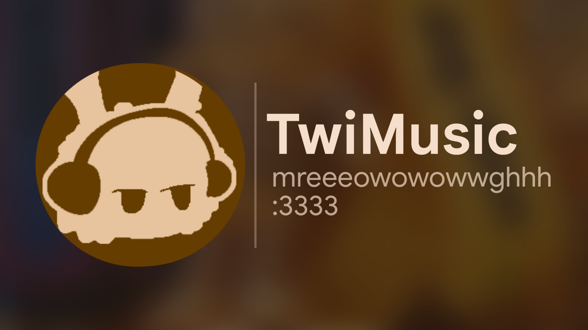
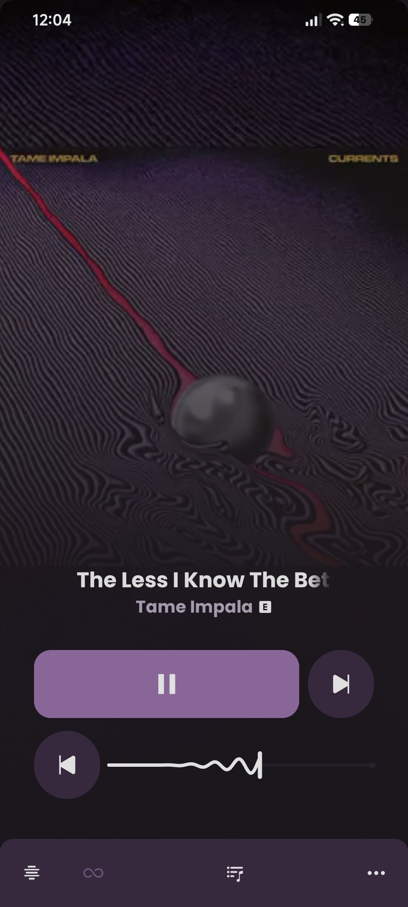
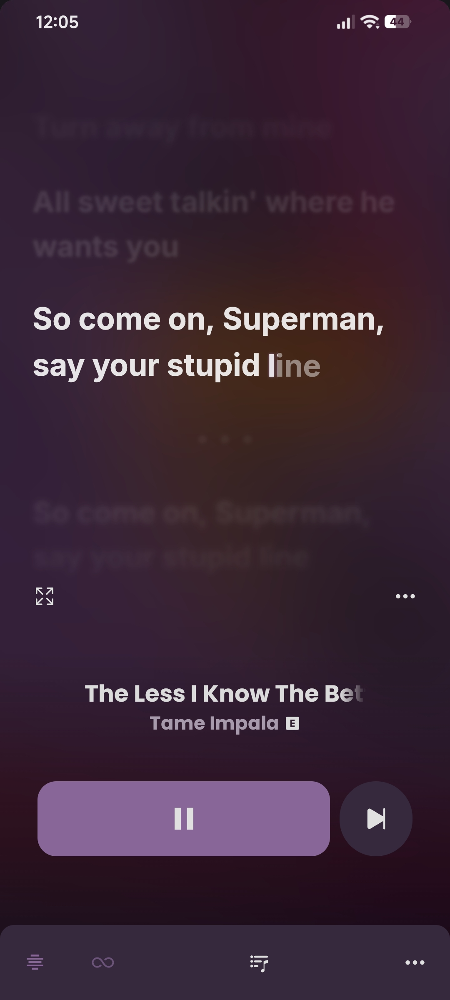
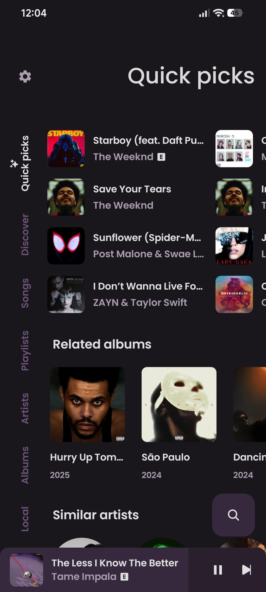
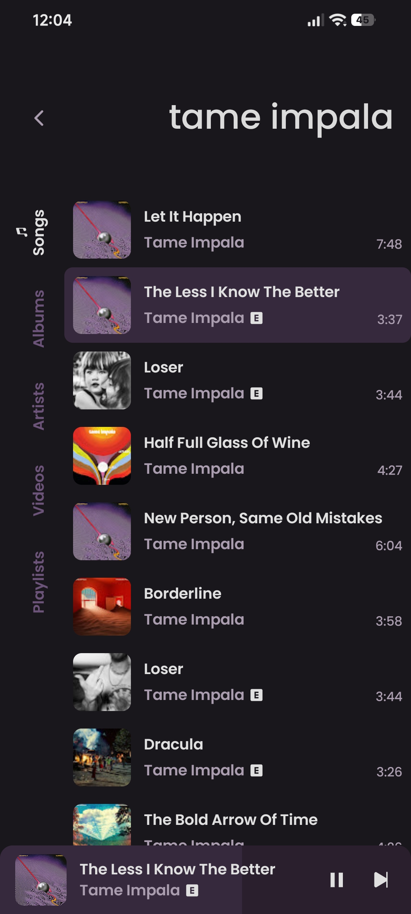
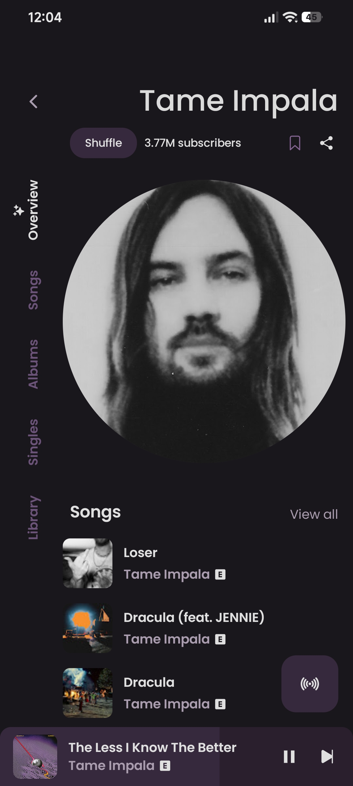
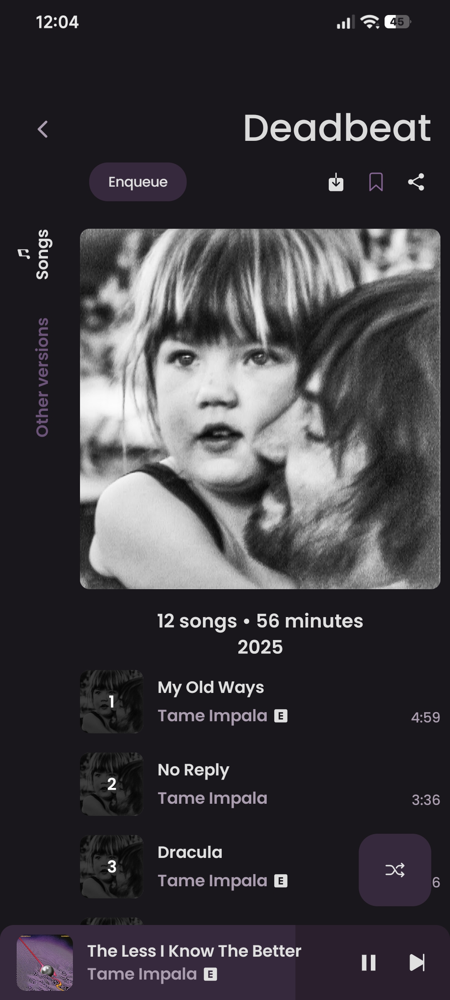

    
    <h1>TwiMusic</h1>
    
a vitune fork nobody asked for

---

  
  
  

  
  
  

## what is this

an android music player for youtube music. i forked [vitune](https://github.com/25huizengek1/ViTune) and kept adding stuff until it felt like mine.

## features

everything vitune does:

- play (almost) any song or video from youtube music
- play music from your device
- background playback
- offline caching
- search songs, albums, artists, videos and playlists
- discover music by mood/genre
- import youtube playlists
- synced lyrics, editable
- local playlists or cloud sync
- dynamic theme, material you, lots of customization
- audio normalization
- android auto
- opens youtube/youtube music links
- ridiculously lightweight apk

and what i added:

- **spotify canvas** looping video behind the player (there's a toggle if you hate fun)
- **word-by-word lyrics** on by default, inactive lines blurred
- **lyrics fallback** through lrclib, musixmatch and kugou
- **tapered wave visualizer** under the controls
- **auto playlist sync** so your playlists aren't empty until you poke them
- **in-app updater** that pulls from github releases, no browser needed

## installation

## credits

i mostly glued other people's work together, so:

- [**ViTune**](https://github.com/25huizengek1/ViTune): the codebase i forked
- [**ViMusic**](https://github.com/vfsfitvnm/ViMusic): where all of this started (and headphones icon)
- [**accompanist-lyrics**](https://github.com/6xingyv/accompanist-lyrics-ui) by [6xingyv](https://github.com/6xingyv) (Apache-2.0): fluid karaoke lyrics UI and syllable timing models
- [**lrc.red**](https://lrc.red): community-driven synchronized lyrics and translation provider
- [**InnerTune**](https://github.com/z-huang/InnerTune): dynamic colors, equalizer, replaygain
- [**Metrolist InnerTube**](https://github.com/metrolistgroup/innertube): the innertube client
- [**LRCLIB**](https://lrclib.net): synced lyrics
- **Spotify Canvas**: reverse-engineered endpoints for the canvas loops
- [**YouTube-Internal-Clients**](https://github.com/zerodytrash/YouTube-Internal-Clients): hidden youtube api client research
- [**ionicons**](https://github.com/ionic-team/ionicons): icons
- [**Flaticon: Ilham Fitrotul Hayat**](https://www.flaticon.com/authors/ilham-fitrotul-hayat): the music note in the logo

made by [twixxty](https://github.com/twixxty).

## disclaimer

not affiliated with, funded, authorized or endorsed by youtube, google llc, spotify or any of their affiliates. all trademarks belong to their owners. if it breaks something, that's your problem.
